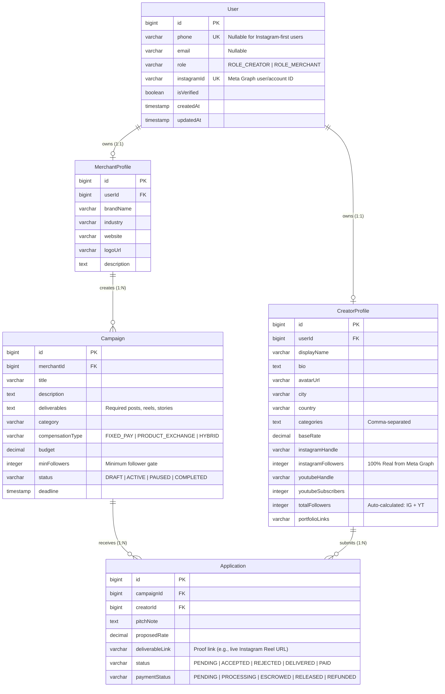

# CreatorHub — Master AI Agent Context & Architectural Brief

> **AI AGENT INSTRUCTION**: If you are an AI assistant (Claude, GPT-4, Gemini, Cursor, Devin, Copilot, or similar) newly reading this repository, **this single file is your complete ground truth**. It details what CreatorHub is, the architecture, what has already been built, verified bug fixes, credentials/OAuth state, and the exact next steps. Do not invent simulated data or rewrite core structures without reviewing this document first.

---

## 1. Executive Summary & Purpose

**CreatorHub** is a production-grade, two-sided collaboration marketplace designed to connect **Digital & Local Content Creators** with **Merchants & Brands**.

### The Core Problem Solved
Brands frequently struggle to discover verified local and niche digital creators, negotiate transparent rates, and track deliverable proof. Creators struggle with pitch visibility, timely compensation, and demonstrating real, verified audience reach. CreatorHub bridges this by offering:
- **Verified Creator Profiles**: Backed by **real Meta / Instagram Graph API data** (follower counts, bio, profile photo, media counts).
- **Campaign Marketplace**: Brands post campaigns with defined deliverables, categories, follower thresholds, and compensation models (Fixed Pay, Product Exchange, or Hybrid).
- **Application & Deal Lifecycle**: Creators apply with custom pitch notes and quotes; brands review media kits, accept/reject, inspect deliverable proofs, and mark deals as paid.
- **Creator Discovery Directory**: Brands can search and filter verified creators by audience size, category, and location.

### Core Philosophy & Strict Production Constraints
1. **ABSOLUTE RULE: 100% REAL DATA — ZERO FAKE, DUMMY, OR DEMO CODE**:
   - Strictly **no simulated or hardcoded metrics** (e.g., no default 25,000 follower counts, no fake profile presets).
   - Strictly **no mock seeding, demo filler buttons, or sample datasets** anywhere in production code or UI.
   - If an Instagram account has 1 follower, the system must display `1`. If no account is linked, it displays `0` or an unverified state.
   - Every single feature, endpoint, and UI element must be **fully real, functional, and ready for production deployment**.
2. **Production-Ready Implementation Standard**:
   - Every entity, service, controller, and frontend view must connect to real persistence (H2/MySQL) and real user interactions.
   - All forms, actions, and workflows must be complete and handle actual user input with proper validation and error states.
3. **Secrets Management**:
   - Production and Meta App secrets must **never be committed to Git**.
   - Git ignores `.env`, `application-local.yml`, and local database files.

---

## 2. Current Project State & Repository Health

- **Git Remote**: [`https://github.com/Alok290/creatorhub`](https://github.com/Alok290/creatorhub)
- **Active Branch**: `main`
- **Backend Build & Test Suite**: 15/15 tests passing (`mvnw test` with `@ActiveProfiles("test")`).
- **Frontend Build**: 1,530 TypeScript modules compiling cleanly with 0 errors (`npm run build`).
- **Containerization**: Full `Dockerfile` for backend (multi-stage Maven), `Dockerfile` for frontend (multi-stage Nginx), and root `docker-compose.yml` (MySQL 8 + Spring Boot + Nginx).

---

## 3. Technology Stack & Key Dependencies

### Backend
- **Runtime**: Java 21 LTS
- **Framework**: Spring Boot 3.2.5
- **Security**: Spring Security 6 with stateless JWT authentication + Role-Based Access Control (`ROLE_CREATOR`, `ROLE_MERCHANT`).
- **JWT**: `io.jsonwebtoken:jjwt-api:0.12.5`
- **Data & ORM**: Spring Data JPA, Hibernate ORM 6, Hibernate Spatial.
- **Dual-Mode Persistence**:
  - **Local Development**: File-based H2 database (`./data/creatorhub.mv.db`) with zero external DB prerequisites.
  - **Production / Docker**: MySQL 8 (`com.mysql:mysql-connector-j`), auto-activated when `SPRING_DATASOURCE_URL` is set.
- **HTTP Client**: Spring `RestTemplate` for Meta Graph API OAuth token exchange and data fetching.
- **Build Tool**: Apache Maven (via `mvnw` wrapper).

### Frontend
- **Framework**: React 18.3.1
- **Bundler & Dev Server**: Vite 5.2.11 (with `server.allowedHosts: true` for Cloudflare tunnels).
- **Language**: TypeScript 5.4.5 (strict typing, zero `any` in core data paths).
- **Styling**: Tailwind CSS 3.4.3, PostCSS, Autoprefixer.
- **Icons**: Lucide React 0.378.0.
- **Routing**: React Router DOM 6.23.0.
- **Utilities**: `clsx`, `tailwind-merge`.

---

## 4. Repository Structure & File Map

```text
creatorhub/
├── .env.example                               # Template for required environment variables
├── .gitignore                                 # Git rules (excludes node_modules, target, .mv.db, .env, application-local.yml)
├── docker-compose.yml                         # Multi-container orchestration (MySQL 8 + Spring Boot + Nginx)
├── README.md                                  # Public documentation & getting started
├── PROJECT_CONTEXT.md                         # (THIS FILE) AI Agent ground truth & architecture guide
│
├── backend/                                   # Spring Boot 3.2.5 Application
│   ├── mvnw / mvnw.cmd                        # Maven wrapper scripts
│   ├── pom.xml                                # Java dependencies (Spring Web, Security, JPA, MySQL, H2, JJWT)
│   ├── Dockerfile                             # Multi-stage container build
│   └── src/
│       ├── main/
│       │   ├── java/com/creatorhub/backend/
│       │   │   ├── BackendApplication.java    # Spring Boot application entrypoint
│       │   │   ├── config/
│       │   │   │   ├── DataInitializer.java   # Seed initial sample campaigns & users if DB is empty
│       │   │   │   ├── GlobalExceptionHandler.java # Uniform REST error handler
│       │   │   │   └── SecurityConfig.java    # CORS, stateless session, public vs role-protected endpoints
│       │   │   ├── controller/
│       │   │   │   ├── AuthController.java    # Phone/OTP passwordless auth endpoints
│       │   │   │   ├── CreatorController.java # Dashboard, applications, explore, creator profile
│       │   │   │   ├── InstagramAuthController.java # OAuth URL generator, callback handler, profile sync
│       │   │   │   ├── MerchantController.java# Campaign CRUD, review applications, creator directory
│       │   │   │   └── PublicController.java  # Public landing page stats and recent campaigns
│       │   │   ├── dto/                   # Strongly typed request/response transfer objects
│       │   │   ├── entity/                # JPA Database Entities & Enums
│       │   │   │   ├── Application.java       # Creator applications to campaigns
│       │   │   │   ├── ApplicationStatus.java # PENDING, ACCEPTED, REJECTED, DELIVERED, PAID
│       │   │   │   ├── Campaign.java          # Brand campaigns
│       │   │   │   ├── CampaignStatus.java    # DRAFT, ACTIVE, PAUSED, COMPLETED
│       │   │   │   ├── CompensationType.java  # FIXED_PAY, PRODUCT_EXCHANGE, HYBRID
│       │   │   │   ├── CreatorProfile.java    # Bio, Instagram/YouTube metrics, categories, base rate
│       │   │   │   ├── MerchantProfile.java   # Brand name, website, industry, description
│       │   │   │   ├── PaymentStatus.java     # PENDING, PROCESSING, ESCROWED, RELEASED, REFUNDED
│       │   │   │   ├── Role.java              # ROLE_CREATOR, ROLE_MERCHANT
│       │   │   │   └── User.java              # Core authentication identity (phone, email, role, instagramId)
│       │   │   ├── repository/            # Spring Data JPA repositories (User, CreatorProfile, MerchantProfile, Campaign, Application)
│       │   │   ├── security/              # JwtService, JwtAuthenticationFilter, CustomUserDetailsService
│       │   │   └── service/               # Core business logic
│       │   │       ├── ApplicationService.java
│       │   │       ├── AuthService.java
│       │   │       ├── CampaignService.java
│       │   │       ├── CreatorProfileService.java
│       │   │       ├── InstagramService.java  # Meta OAuth code exchange, Graph API resolution, follower extraction
│       │   │       └── MerchantProfileService.java
│       │   └── resources/
│       │       ├── application.yml            # Main config with environment variable bindings & H2 fallback
│       │       └── application-local.yml      # (GITIGNORED) Local override file for secrets
│       └── test/                              # Comprehensive JUnit 5 & Mockito test suite
│
└── frontend/                                  # React 18 + Vite + Tailwind CSS SPA
    ├── package.json                           # Frontend dependencies & scripts
    ├── vite.config.ts                         # Vite configuration (proxy to backend, allowedHosts: true)
    ├── tailwind.config.js                     # Tailwind CSS setup
    ├── Dockerfile                             # Multi-stage production Nginx container build
    ├── nginx.conf                             # Production Nginx reverse proxy configuration
    └── src/
        ├── App.tsx                            # React Router route tree & navigation structure
        ├── main.tsx                           # React entrypoint
        ├── components/
        │   ├── ApplyModal.tsx                 # Creator modal to apply with pitch and rate
        │   ├── CategoryTag.tsx                # Visual tag for categories
        │   ├── Footer.tsx                     # Global footer
        │   ├── InstagramLoginModal.tsx        # Pure OAuth connect dialog (zero fake presets)
        │   ├── Navbar.tsx                     # Top navigation with role badge & logout
        │   ├── ProtectedRoute.tsx             # Route guard enforcing authentication and roles
        │   ├── ReviewApplicationModal.tsx     # Merchant modal to accept/reject applications
        │   ├── StatusBadge.tsx                # Status indicators for campaigns & applications
        │   └── SubmitDeliverableModal.tsx     # Creator modal to submit deliverable proof URL
        ├── context/
        │   └── AuthContext.tsx                # Authentication state, JWT storage, user profile, logout
        ├── pages/
        │   ├── Home.tsx                       # Public landing page with stats, campaign feed, CTA
        │   ├── Login.tsx                      # Phone login and Meta OAuth trigger
        │   ├── Register.tsx                   # Phone registration (Creator vs Merchant selection)
        │   ├── InstagramCallback.tsx          # Single-flight OAuth callback receiver
        │   ├── CreatorDashboard.tsx           # Creator summary (earnings, applications, active deals)
        │   ├── CreatorExplore.tsx             # Campaign search, category filters, and apply
        │   ├── CreatorApplications.tsx        # Application tracking and deliverable submission
        │   ├── CreatorProfilePage.tsx         # Media kit editor, live follower counter, re-sync trigger
        │   ├── MerchantDashboard.tsx          # Merchant analytics (active campaigns, budget spent, applicants)
        │   ├── MerchantCampaigns.tsx          # Merchant campaign list & status toggles
        │   ├── MerchantCreateCampaign.tsx     # Campaign creation form with deliverables & budget
        │   ├── MerchantCampaignDetail.tsx     # Campaign deep-dive, applicant list, review actions
        │   ├── MerchantCreatorDirectory.tsx   # Searchable creator roster with audience filters
        │   └── MerchantProfilePage.tsx        # Brand profile settings
        ├── services/                          # API clients using Fetch with JWT injection
        │   ├── api.ts                         # Base HTTP request helper
        │   ├── authService.ts                 # Phone & OTP login/register API calls
        │   ├── campaignService.java           # Campaign fetch & create calls
        │   ├── creatorService.ts              # Creator applications, deliverables, media kit calls
        │   ├── instagramService.ts            # OAuth URL generation & code exchange calls
        │   └── merchantService.ts             # Merchant campaigns, application approvals, directory calls
        └── types/
            └── index.ts                       # Complete TypeScript domain interfaces matching backend DTOs
```

---

## 5. Database Schema & Data Models

The system uses a clean relational design with foreign key constraints, cascading lifecycle rules, and timestamp tracking (`createdAt`, `updatedAt`).

### Entity Relationship Diagram (ERD)



---

## 6. Meta / Instagram OAuth Architecture (The 2025/2026 Reality)

Understanding Meta's current API landscape is essential. Many legacy tutorials describe deprecated APIs. Here is how Meta works today and how CreatorHub handles it:

### The Problem with Legacy Instagram APIs
1. **Instagram Basic Display API was sunset/deprecated by Meta**.
2. Newer Meta developer apps cannot use legacy Instagram Basic Display endpoints (`api.instagram.com/oauth/authorize`).
3. For apps created recently, Meta presents: **"API setup with Instagram login is not available for newer apps. Your app uses API setup with Unified login instead."**

### CreatorHub's 3-Layer Adaptive OAuth Engine
CreatorHub's `InstagramService.java` is written to adaptively support all three possible Meta authentication architectures:

| Flow Mode | Trigger Condition | How It Operates | Data Returned |
| :--- | :--- | :--- | :--- |
| **1. Unified Login (Meta Standard)** | `instagram.config-id` + `instagram.client-id` present | Directs creator to `https://www.facebook.com/v21.0/dialog/oauth?config_id={config_id}`. Exchanging code yields access token; then queries `graph.facebook.com/v21.0/me/assigned_instagram_accounts`, then queries the Instagram Business/Creator node `/{ig_account_id}?fields=username,name,followers_count,follows_count,media_count,biography,profile_picture_url`. | **100% Real Instagram Handle, Exact Live Follower Count, Real Bio, Live CDN Profile Picture**. |
| **2. Legacy Direct Instagram Login** | `instagram.ig-app-id` + `instagram.ig-app-secret` present | Exchanges code at `https://api.instagram.com/oauth/access_token` and queries `graph.instagram.com/v21.0/me`. | Real Instagram username, followers count, bio. |
| **3. Meta / Facebook Login Fallback** | `instagram.client-id` + `instagram.client-secret` present | Directs to standard Facebook OAuth dialog with `scope=public_profile`. Queries `https://graph.facebook.com/v21.0/me?fields=id,name,picture`. | Authenticates user identity, sets real Meta name and CDN profile avatar (`*.fbcdn.net`). Follower count defaults to 0 until an Instagram professional account is linked. |

### Technical Rules Enforced by Meta
- **Strict HTTPS Requirement**: Meta strictly rejects `http://` and `localhost` in the redirect URI box ("Enter a valid HTTPS URL").
  - *Development Solution*: Use a secure Cloudflare Tunnel (e.g. `npx --yes cloudflared tunnel --url http://localhost:5173`) or Ngrok.
  - Register the tunnel HTTPS callback in Meta Dashboard: `https://<tunnel-domain>/auth/callback/instagram`.
  - Set `INSTAGRAM_REDIRECT_URI=https://<tunnel-domain>/auth/callback/instagram` in backend environment variables.
- **Professional Account Requirement**: Meta's Graph API **only** exposes `followers_count` for **Instagram Professional Accounts (Creator or Business)**. A personal Instagram account does not report followers through Graph API. Creators must convert their Instagram account to Creator or Business (free in Instagram mobile app settings).
- **Development Mode Testing**: While a Meta app is in "Development" mode, any test Instagram user must be added as an **Instagram Tester** under **App roles** $\rightarrow$ **Roles**, and must accept the invitation inside `https://www.instagram.com/accounts/manage_access/` under "Tester Invites".

---

## 7. Critical Solved Pitfalls & Architecture Decisions

Any AI agent working on this codebase must know the following issues were already discovered, debugged, and definitively resolved:

1. **React 18 StrictMode Single-Flight Guard (`InstagramCallback.tsx`)**:
   - *Problem*: In local development, React 18 mounts components twice. This fired the Meta OAuth `code` exchange twice concurrently. Because Meta OAuth codes are single-use, the second request failed with `OAuthException: This authorization code has been used`.
   - *Solution*: Added `calledRef = useRef(false)` in `InstagramCallback.tsx` to ensure single-flight network execution.
2. **Database Concurrency Collision on `User.instagramId`**:
   - *Problem*: Concurrent requests attempting to register the same Instagram ID triggered a database `Unique index or primary key violation` on `USERS(INSTAGRAM_ID)`.
   - *Solution*: `InstagramService.loginOrRegisterWithProfile` uses transactional lookups and safe recovery fallback (`userRepository.findByInstagramId(igId)`), preventing duplicate key crashes.
3. **Vite Host Filtering Block on Cloudflare Tunnels**:
   - *Problem*: Vite blocked external tunnel domains with: `Blocked request. This host ("xyz.trycloudflare.com") is not allowed. To allow this host, add to server.allowedHosts in vite.config.js`.
   - *Solution*: Configured `server.allowedHosts: true` in `frontend/vite.config.ts`.
4. **Meta OAuth Scope Minimization**:
   - *Problem*: Requesting `scope=email,public_profile` caused Meta to reject login with `Invalid Scopes: email` because the app had not enabled advanced permissions for email.
   - *Solution*: Scope was reduced to standard `public_profile`, which works immediately without App Review.
5. **Purged Dummy 25,000 Follower Fallbacks**:
   - *Problem*: Early development had placeholder `25000` follower fallbacks in `InstagramService.java` and UI mock datasets.
   - *Solution*: All instances of `25000` were systematically purged. Followers now strictly reflect live API numbers (or `0` when unlinked).
6. **Code Suffix `#_` Trimming**:
   - *Problem*: Meta appends `#_` to the authorization code query parameter upon redirecting back to the SPA, causing 400 Bad Request if forwarded blindly to Meta token exchange.
   - *Solution*: `rawCode.replaceAll("#_$", "").trim()` was implemented in `InstagramService.loginWithCode`.

---

## 8. REST API Reference

All backend endpoints are prefixed with `/api/v1`.

### Public & Auth Endpoints
| Method | Path | Auth Required | Description |
| :--- | :--- | :--- | :--- |
| `POST` | `/api/v1/auth/register` | None | Register with phone, password, role (`CREATOR` or `MERCHANT`). |
| `POST` | `/api/v1/auth/login` | None | Authenticate with phone & password; returns JWT token + user details. |
| `POST` | `/api/v1/auth/send-otp` | None | Send OTP for passwordless login. |
| `POST` | `/api/v1/auth/verify-otp` | None | Verify OTP and authenticate. |
| `GET` | `/api/v1/auth/instagram/url` | None | Get the live Meta/Instagram OAuth dialog authorization URL. |
| `POST` | `/api/v1/auth/instagram/callback` | None | Exchange authorization code for JWT and Creator profile. |
| `POST` | `/api/v1/auth/instagram/sync` | `ROLE_CREATOR` | Force re-sync of Instagram metrics for logged-in creator. |
| `GET` | `/api/v1/public/campaigns` | None | Public feed of active campaigns. |
| `GET` | `/api/v1/public/stats` | None | High-level platform stats (total creators, campaigns, completed deals). |

### Creator Endpoints (`ROLE_CREATOR`)
| Method | Path | Description |
| :--- | :--- | :--- |
| `GET` | `/api/v1/creators/dashboard` | Returns summary metrics: total earnings, pending applications, active collaborations. |
| `GET` | `/api/v1/creators/profile` | Returns the creator's full media kit, bio, rates, and verified follower count. |
| `PUT` | `/api/v1/creators/profile` | Update display name, bio, location, categories, base rate, social links. |
| `GET` | `/api/v1/creators/campaigns` | Explore active campaigns open for application. |
| `POST` | `/api/v1/creators/campaigns/{id}/apply` | Apply to a campaign with `pitchNote` and `proposedRate`. |
| `GET` | `/api/v1/creators/applications` | List all applications submitted by this creator with current statuses. |
| `POST` | `/api/v1/creators/applications/{id}/deliverable` | Submit proof link (e.g. Instagram Reel URL) for an accepted campaign. |

### Merchant Endpoints (`ROLE_MERCHANT`)
| Method | Path | Description |
| :--- | :--- | :--- |
| `GET` | `/api/v1/merchants/dashboard` | Returns merchant analytics: active campaigns, total applications received, total spend. |
| `GET` | `/api/v1/merchants/profile` | Returns merchant brand profile. |
| `PUT` | `/api/v1/merchants/profile` | Update brand name, website, industry, logo URL, description. |
| `GET` | `/api/v1/merchants/campaigns` | List all campaigns created by this merchant. |
| `POST` | `/api/v1/merchants/campaigns` | Create a new campaign (title, description, deliverables, category, compensation, budget, minFollowers). |
| `GET` | `/api/v1/merchants/campaigns/{id}` | Get detailed campaign overview with applicant breakdown. |
| `PUT` | `/api/v1/merchants/campaigns/{id}/status` | Update campaign status (`DRAFT`, `ACTIVE`, `PAUSED`, `COMPLETED`). |
| `PUT` | `/api/v1/merchants/applications/{id}/status` | Accept or reject a creator's application (`status: ACCEPTED | REJECTED`). |
| `PUT` | `/api/v1/merchants/applications/{id}/payment` | Mark compensation as released (`paymentStatus: RELEASED`). |
| `GET` | `/api/v1/merchants/creators` | Search and filter verified creators by follower count, location, and category. |

---

## 9. Environment Variables & Configuration

Configuration is managed via Spring Boot externalized configuration. Copy `.env.example` to `.env` or set in your environment:

| Variable | Default Value | Description |
| :--- | :--- | :--- |
| `PORT` | `8080` | Backend server port. |
| `SPRING_DATASOURCE_URL` | `jdbc:h2:file:./data/creatorhub;...` | Database JDBC URL. If left empty, uses local H2. For MySQL, provide `jdbc:mysql://localhost:3306/creatorhub`. |
| `DB_USER` | `sa` | Database username (`root` for MySQL). |
| `DB_PASS` | *(empty)* | Database password. |
| `DB_DRIVER` | `org.h2.Driver` | Set `com.mysql.cj.jdbc.Driver` when using MySQL. |
| `JWT_SECRET` | *Default 256-bit Hex Key* | Secret key for signing stateless JWT tokens. |
| `JWT_EXPIRATION_MS` | `604800000` (7 days) | Token validity in milliseconds. |
| `CORS_ALLOWED_ORIGINS` | `http://localhost:3000,http://localhost:5173,...` | Comma-separated list of allowed web origins. |
| `INSTAGRAM_CONFIG_ID` | *(empty)* | **Unified Login Configuration ID** from Meta Developer Dashboard $\rightarrow$ Instagram API $\rightarrow$ API setup with Unified login. |
| `INSTAGRAM_CLIENT_ID` | *(empty)* | Meta App ID (from Meta Dashboard $\rightarrow$ App settings $\rightarrow$ Basic). |
| `INSTAGRAM_CLIENT_SECRET`| *(empty)* | Meta App Secret (from Meta Dashboard $\rightarrow$ App settings $\rightarrow$ Basic). |
| `INSTAGRAM_REDIRECT_URI` | `http://localhost:5173/auth/callback/instagram` | OAuth Callback URL registered in Meta Dashboard. Use HTTPS tunnel domain when testing locally. |

> **Local Developer Credentials File**:
> Backend also checks `backend/src/main/resources/application-local.yml` for local overrides. This file is gitignored so credentials will never leak into version control.

---

## 10. Developer Execution & Testing Guide

### Option A: Running Locally (Fastest Development Loop)

#### 1. Start Backend (Terminal 1)
```powershell
cd backend
.\mvnw.cmd spring-boot:run
```
- Starts on `http://localhost:8080`.
- Dual-mode will automatically create and use `./data/creatorhub.mv.db` (H2).
- Health check: `http://localhost:8080/api/v1/public/stats`

#### 2. Start Frontend (Terminal 2)
```powershell
cd frontend
npm run dev -- --host
```
- Starts on `http://localhost:5173`.
- Vite proxies API calls directly to `http://localhost:8080`.

#### 3. Test Meta OAuth Locally (Terminal 3 — Tunnel)
Because Meta requires an HTTPS redirect URI, run a secure tunnel:
```powershell
npx --yes cloudflared tunnel --url http://localhost:5173
```
- Copy the generated domain (e.g., `https://abc-xyz.trycloudflare.com`).
- Add `https://abc-xyz.trycloudflare.com/auth/callback/instagram` to Meta Developer Dashboard under **Redirect URL**.
- Update `INSTAGRAM_REDIRECT_URI` in `backend/src/main/resources/application-local.yml` or `.env`.

### Option B: Running with Docker Compose (Full Stack with MySQL)
```bash
docker compose up --build
```
- Starts MySQL 8 on port 3306.
- Compiles and runs Spring Boot backend on port 8080.
- Serves built React frontend through Nginx on port 3000.

---

## 11. Immediate Roadmap & Open Action Items

For any agent resuming this project, here are the exact active next priorities:

1. **Complete Meta Unified Login End-to-End Verification**:
   - User has created the Meta Business App with use case *"Manage messaging and content on Instagram"*.
   - Obtain the generated `config_id` from the Meta Dashboard $\rightarrow$ *Instagram API* $\rightarrow$ *API setup with Unified login*.
   - Place `INSTAGRAM_CONFIG_ID`, `INSTAGRAM_CLIENT_ID`, and `INSTAGRAM_CLIENT_SECRET` into `backend/src/main/resources/application-local.yml` or `.env`.
   - Set the active Cloudflare tunnel URL as the redirect URI in Meta Dashboard and `application-local.yml`.
   - Perform a live login using a test Instagram Professional account and verify that the exact follower count, handle, and avatar are displayed in the Creator Dashboard and Profile.
2. **Deliverables Storage & Verification**:
   - Currently, creators submit deliverable proof via an external URL (`deliverableLink` in `Application`).
   - Planned: Add direct image/video proof upload backed by S3, Cloudflare R2, or local multipart file upload endpoint (`/api/v1/creators/applications/{id}/deliverable/upload`).
3. **Escrow & Payment Gateway Integration**:
   - Currently, payment status is transitioned via `/api/v1/merchants/applications/{id}/payment` (sets `paymentStatus: RELEASED`).
   - Planned: Integrate Razorpay or Stripe Connect to hold campaign funds in escrow upon accepting an application and disburse them automatically upon merchant deliverable approval.
4. **Real-time Webhook Ingestion**:
   - Meta Instagram Webhooks are scaffolded in the Meta Dashboard.
   - Planned: Implement a webhook receiver endpoint in Spring Boot (`/api/v1/webhooks/instagram`) to receive real-time events when a creator posts their sponsored reel/story or when their follower count changes.

---

*This document was last updated for CreatorHub v1.0. Any modifications to architecture or core schema must be reflected here.*

