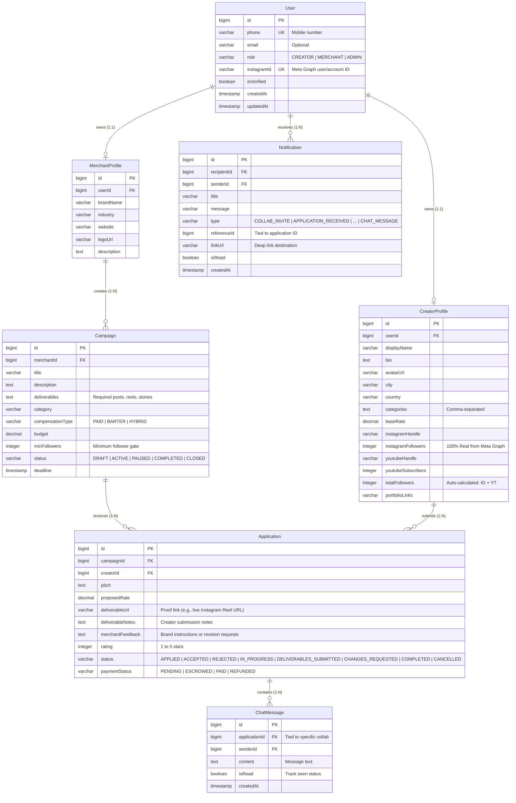
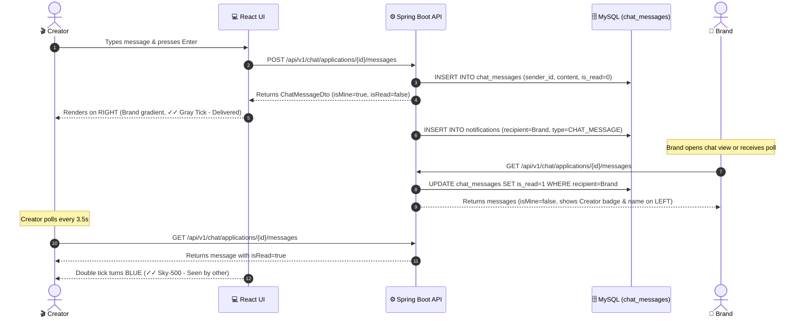
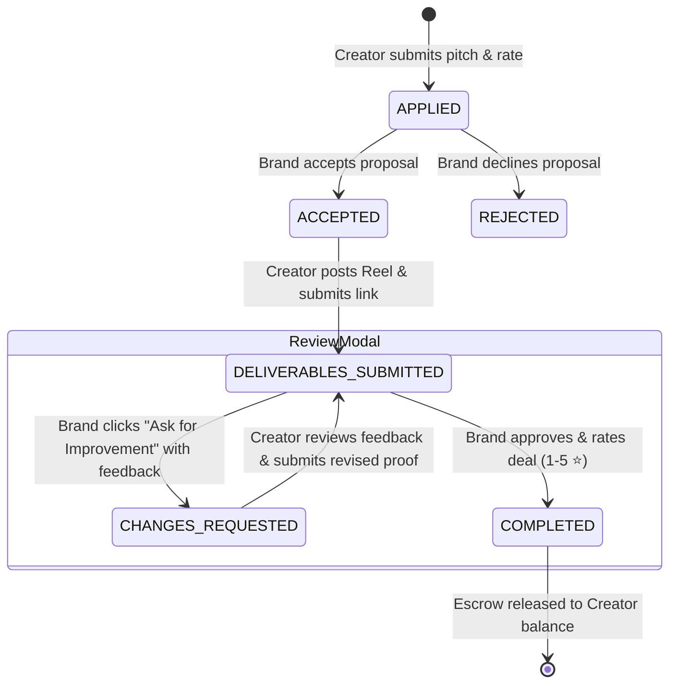
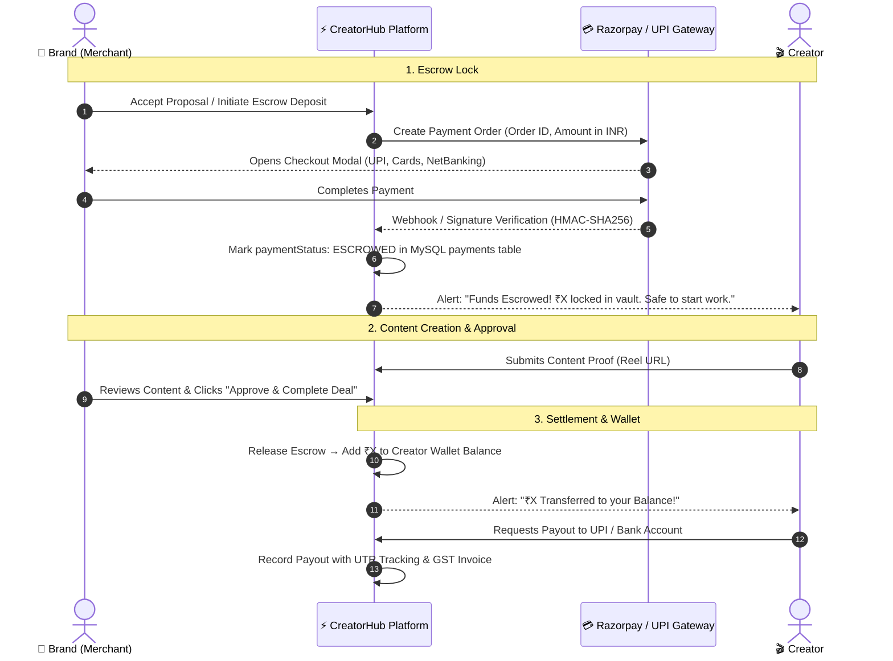

# CreatorHub — Master AI Agent Context & Architectural Brief

> **AI AGENT INSTRUCTION**: If you are an AI assistant (Claude, GPT-4, Gemini, Cursor, Devin, Copilot, or similar) newly reading this repository, **this single file is your complete ground truth**. It details what CreatorHub is, the architecture, what has already been built, verified bug fixes, credentials/OAuth state, and the exact workflows for messaging, notifications, deliverable revisions, and payments. Do not invent simulated data or rewrite core structures without reviewing this document first.

---

## 1. Executive Summary & Purpose

**CreatorHub** is a production-grade, two-sided collaboration marketplace designed to connect **Digital & Local Content Creators** with **Merchants & Brands**.

### The Core Problem Solved
Brands frequently struggle to discover verified local and niche digital creators, negotiate transparent rates, and track deliverable proof. Creators struggle with pitch visibility, timely compensation, and demonstrating real, verified audience reach. CreatorHub bridges this by offering:
- **Verified Creator Profiles**: Backed by **real Meta / Instagram Graph API data** (follower counts, bio, profile photo, media counts).
- **Campaign & Collab Marketplace**: Brands post collaborations with defined deliverables, categories, follower thresholds, and compensation models (Fixed Pay, Product Exchange, or Hybrid).
- **Application & Deal Lifecycle**: Creators apply with custom pitch notes and quotes; brands review media kits, accept/reject, request improvements, inspect deliverable proofs, and complete deals.
- **In-App Messaging & Collaboration Chat**: Direct real-time chat between Brand and Creator for active deals, complete with sender identification, delivery double ticks, and blue seen ticks.
- **Real-Time Notification System**: Instant business alerts with unread badge counter, deep linking, and automated triggers across the collab lifecycle.
- **Milestone Escrow & Payment System**: Secure escrow holding brand funds in a vault during production, releasing to creator wallets upon deliverable approval, with UPI and Bank Account payouts.
- **Creator Discovery Directory**: Brands can search and filter verified creators by audience size, category, and location.

### Core Philosophy & Strict Production Constraints
1. **ABSOLUTE RULE: 100% REAL DATA — ZERO FAKE, DUMMY, OR DEMO CODE**:
   - Strictly **no simulated or hardcoded metrics** (e.g., no default 25,000 follower counts, no fake profile presets).
   - Strictly **no mock seeding, demo filler buttons, or sample datasets** anywhere in production code or UI.
   - If an Instagram account has 1 follower, the system must display `1`. If no account is linked, it displays `0` or an unverified state.
   - Every single feature, endpoint, and UI element must be **fully real, functional, and ready for production deployment**.
2. **Production-Ready Implementation Standard**:
   - Every entity, service, controller, and frontend view connects to real persistence (MySQL 8.0 / H2) and real user interactions.
   - All forms, actions, and workflows are complete and handle actual user input with proper validation and error states.
3. **Secrets Management**:
   - Production, Meta App, and Payment Gateway secrets must **never be committed to Git**.
   - Git ignores `.env`, `application-local.yml`, and local database files.

---

## 2. Current Project State & Repository Health

- **Git Remote**: [`https://github.com/Alok290/creatorhub`](https://github.com/Alok290/creatorhub)
- **Active Branch**: `main` (clean working tree, up to date with remote).
- **Backend Build & Test Suite**: Spring Boot 3.2.5 on Java 21 compiling cleanly with 0 errors.
- **Frontend Build**: 1,537 TypeScript modules compiling cleanly with 0 errors (`npm run build`).
- **Containerization**: Full `Dockerfile` for backend (multi-stage Maven), `Dockerfile` for frontend (multi-stage Nginx), and root `docker-compose.yml` (MySQL 8 + Spring Boot + Nginx).
- **Live Local Ports**:
  - Frontend: `http://localhost:5173` (Vite)
  - Backend: `http://localhost:8080` (Spring Boot REST API)
  - Database: `localhost:3306` (MySQL 8.0 `creatorhub` schema)

---

## 3. Technology Stack & Key Dependencies

### Backend
- **Runtime**: Java 21 LTS
- **Framework**: Spring Boot 3.2.5
- **Security**: Spring Security 6 with stateless JWT authentication + Role-Based Access Control (`ROLE_CREATOR`, `ROLE_MERCHANT`).
- **JWT**: `io.jsonwebtoken:jjwt-api:0.12.5`
- **Data & ORM**: Spring Data JPA, Hibernate ORM 6, Hibernate Spatial.
- **Persistence**: Local MySQL 8.0 database (`creatorhub`) with dual-mode fallback to H2 for isolated unit tests.
- **HTTP Client**: Spring `RestTemplate` for Meta Graph API OAuth token exchange and data fetching.
- **Payment Processing**: HMAC-SHA256 signature verification and Orders API integration for Razorpay / UPI / Cards.
- **Build Tool**: Apache Maven (via `mvnw` wrapper).

### Frontend
- **Framework**: React 18.3.1
- **Bundler & Dev Server**: Vite 5.2.11 (with `server.allowedHosts: true` for Cloudflare tunnels).
- **Language**: TypeScript 5.4.5 (strict typing, zero `any` in core data paths).
- **Styling**: Tailwind CSS 3.4.3, PostCSS, Autoprefixer.
- **Icons**: Lucide React 0.378.0.
- **Routing**: React Router DOM 6.23.0.
- **Utilities**: `clsx`, `tailwind-merge`.

---

## 4. Repository Structure & File Map

```text
creatorhub/
├── .env.example                               # Template for required environment variables
├── .gitignore                                 # Git rules (excludes node_modules, target, .env, application-local.yml)
├── docker-compose.yml                         # Multi-container orchestration (MySQL 8 + Spring Boot + Nginx)
├── README.md                                  # Public documentation & getting started
├── PROJECT_CONTEXT.md                         # (THIS FILE) AI Agent ground truth & architecture guide
│
├── backend/                                   # Spring Boot 3.2.5 Application
│   ├── mvnw / mvnw.cmd                        # Maven wrapper scripts
│   ├── pom.xml                                # Java dependencies (Spring Web, Security, JPA, MySQL, H2, JJWT)
│   ├── Dockerfile                             # Multi-stage container build
│   └── src/
│       ├── main/
│       │   ├── java/com/creatorhub/backend/
│       │   │   ├── BackendApplication.java    # Spring Boot application entrypoint
│       │   │   ├── config/
│       │   │   │   ├── DataInitializer.java   # Auto-schema migrations (VARCHAR enum types) & clean initialization
│       │   │   │   ├── GlobalExceptionHandler.java # Uniform REST error handler
│       │   │   │   └── SecurityConfig.java    # CORS, stateless session, public vs role-protected endpoints
│       │   │   ├── controller/
│       │   │   │   ├── AuthController.java    # Phone/OTP passwordless auth & /auth/me
│       │   │   │   ├── ChatController.java    # Direct collab messaging & thread list endpoints
│       │   │   │   ├── CreatorController.java # Dashboard, applications, explore, creator profile
│       │   │   │   ├── InstagramAuthController.java # OAuth URL generator, callback handler, profile sync
│       │   │   │   ├── MerchantController.java# Collab CRUD, review applications, creator directory
│       │   │   │   ├── NotificationController.java # Unread counts, list, mark-as-read endpoints
│       │   │   │   └── PublicController.java  # Public landing page stats and recent collabs
│       │   │   ├── dto/                   # Strongly typed request/response transfer objects
│       │   │   │   ├── ChatMessageDto.java    # Message payload with isMine, isRead, timestamps, sender details
│       │   │   │   ├── ChatThreadDto.java     # Conversation summary with partner name, avatar, unread count
│       │   │   │   ├── NotificationDto.java   # Real-time alert payload with deep links and types
│       │   │   │   └── SendMessageRequestDto.java # Incoming message validation
│       │   │   ├── entity/                # JPA Database Entities & Enums
│       │   │   │   ├── Application.java       # Collab applications & deal contracts
│       │   │   │   ├── ApplicationStatus.java # APPLIED, ACCEPTED, REJECTED, IN_PROGRESS, DELIVERABLES_SUBMITTED, CHANGES_REQUESTED, COMPLETED, CANCELLED
│       │   │   │   ├── Campaign.java          # Brand collaboration posts
│       │   │   │   ├── CampaignStatus.java    # DRAFT, ACTIVE, PAUSED, COMPLETED, CLOSED
│       │   │   │   ├── ChatMessage.java       # Persistent chat entity with foreign keys & is_read state
│       │   │   │   ├── CompensationType.java  # PAID, BARTER, HYBRID
│       │   │   │   ├── CreatorProfile.java    # Bio, Instagram/YouTube metrics, categories, base rate
│       │   │   │   ├── MerchantProfile.java   # Brand name, website, industry, description, logo
│       │   │   │   ├── Notification.java      # User notification entity with recipient, type, link, is_read
│       │   │   │   ├── NotificationType.java  # COLLAB_INVITE, APPLICATION_RECEIVED, APPLICATION_ACCEPTED, APPLICATION_REJECTED, DELIVERABLES_SUBMITTED, CHANGES_REQUESTED, COLLAB_COMPLETED, CHAT_MESSAGE
│       │   │   │   ├── PaymentStatus.java     # PENDING, ESCROWED, PAID, REFUNDED
│       │   │   │   ├── Role.java              # CREATOR, MERCHANT, ADMIN
│       │   │   │   └── User.java              # Core identity (phone, email, role, instagramId)
│       │   │   ├── repository/            # Spring Data JPA repositories
│       │   │   │   ├── ApplicationRepository.java
│       │   │   │   ├── CampaignRepository.java
│       │   │   │   ├── ChatMessageRepository.java # Find messages, latest activity, unread counts, markAllAsRead
│       │   │   │   ├── CreatorProfileRepository.java
│       │   │   │   ├── MerchantProfileRepository.java
│       │   │   │   ├── NotificationRepository.java# Find top notifications, count unread, markAsRead
│       │   │   │   └── UserRepository.java
│       │   │   ├── security/              # JwtService, JwtAuthenticationFilter, CustomUserDetailsService
│       │   │   └── service/               # Core business logic
│       │   │       ├── ApplicationService.java# Deals, proposals, deliverable submission & revision workflows
│       │   │       ├── AuthService.java       # Registration, login, profile fetch
│       │   │       ├── CampaignService.java   # Collab postings & discovery
│       │   │       ├── ChatService.java       # Direct messaging, auto-read marking, thread aggregation
│       │   │       ├── CreatorProfileService.java
│       │   │       ├── InstagramService.java  # Meta OAuth code exchange, Graph API resolution
│       │   │       ├── MerchantProfileService.java
│       │   │       └── NotificationService.java# System alerts, real-time message triggers, mark read
│       │   └── resources/
│       │       ├── application.yml            # Main config with MySQL datasource bindings
│       │       └── application-local.yml      # (GITIGNORED) Local override file for secrets
│       └── test/                              # Comprehensive JUnit 5 & Mockito test suite
│
└── frontend/                                  # React 18 + Vite + Tailwind CSS SPA
    ├── package.json                           # Frontend dependencies & scripts
    ├── vite.config.ts                         # Vite configuration (proxy to backend, allowedHosts: true)
    ├── tailwind.config.js                     # Tailwind CSS setup
    ├── Dockerfile                             # Multi-stage production Nginx container build
    ├── nginx.conf                             # Production Nginx reverse proxy configuration
    └── src/
        ├── App.tsx                            # React Router route tree with MainLayout (viewport height lock)
        ├── main.tsx                           # React entrypoint
        ├── components/
        │   ├── ApplyModal.tsx                 # Creator modal to apply with pitch and rate
        │   ├── CategoryTag.tsx                # Visual tag for categories
        │   ├── CollabChatModal.tsx            # Floating modal chat with double ticks & sender badges
        │   ├── Footer.tsx                     # Global footer (hidden on /messages to prevent scroll jumps)
        │   ├── InstagramLoginModal.tsx        # Pure OAuth connect dialog (zero fake presets)
        │   ├── InviteCreatorModal.tsx         # Brand modal to invite verified creators to collabs
        │   ├── Navbar.tsx                     # Top navigation with NotificationBell, role badge & logout
        │   ├── NotificationBell.tsx           # Popover bell with real-time unread badge counter & deep linking
        │   ├── ProtectedRoute.tsx             # Route guard enforcing authentication and roles
        │   ├── ReviewApplicationModal.tsx     # Brand modal with "Approve Deal" AND "Ask for Improvement"
        │   ├── StatusBadge.tsx                # Status indicators (Applied, Accepted, Changes Requested, etc.)
        │   └── SubmitDeliverableModal.tsx     # Creator modal to submit post proof & view revision feedback
        ├── context/
        │   └── AuthContext.tsx                # Authentication state, JWT storage, user profile, logout
        ├── pages/
        │   ├── Home.tsx                       # Public landing page with stats, collab feed, CTA
        │   ├── Login.tsx                      # Phone login and Meta OAuth trigger
        │   ├── Register.tsx                   # Phone registration (Creator vs Merchant selection)
        │   ├── InstagramCallback.tsx          # Single-flight OAuth callback receiver
        │   ├── CollabMessagesPage.tsx         # Dedicated full-page inbox with threads, search & real-time chat
        │   ├── CreatorDashboard.tsx           # Creator summary (earnings, applications, active deals)
        │   ├── CreatorExplore.tsx             # Collab search, category filters, and apply
        │   ├── CreatorApplications.tsx        # Deal tracking, deliverable proof submission & revision alerts
        │   ├── CreatorProfilePage.tsx         # Media kit editor, live follower counter, re-sync trigger
        │   ├── MerchantDashboard.tsx          # Merchant analytics (active collabs, budget spent, applicants)
        │   ├── MerchantCampaigns.tsx          # Merchant collab list & status toggles
        │   ├── MerchantCreateCampaign.tsx     # Collab creation form with deliverables & budget
        │   ├── MerchantCampaignDetail.tsx     # Collab deep-dive, applicant list, review & revision actions
        │   ├── MerchantCreatorDirectory.tsx   # Searchable creator roster with audience filters
        │   ├── MerchantCreatorDetail.tsx      # Comprehensive creator media kit, social stats & invite action
        │   └── MerchantProfilePage.tsx        # Brand profile settings
        ├── services/                          # API clients using Fetch with JWT injection
        │   ├── api.ts                         # Base HTTP request helper
        │   ├── authService.ts                 # Phone & OTP login/register API calls
        │   ├── campaignService.ts             # Collab fetch & create calls
        │   ├── chatService.ts                 # Direct messages & threads API
        │   ├── creatorService.ts              # Creator applications, deliverables, media kit calls
        │   ├── instagramService.ts            # OAuth URL generation & code exchange calls
        │   ├── merchantService.ts             # Merchant collabs, application approvals, directory calls
        │   └── notificationService.ts         # User notifications & unread counter API
        └── types/
            └── index.ts                       # Complete TypeScript domain interfaces matching backend DTOs
```

---

## 5. Database Schema & Data Models

The system uses a clean relational design in MySQL 8.0 with foreign key constraints, indexing on high-frequency lookup fields (`recipient_id`, `application_id`, `created_at`, `is_read`), and automatic enum column migrations (`VARCHAR(50)`).

### Entity Relationship Diagram (ERD)



---

## 6. Meta / Instagram OAuth Architecture (The 2025/2026 Reality)

Understanding Meta's current API landscape is essential. Many legacy tutorials describe deprecated APIs. Here is how Meta works today and how CreatorHub handles it:

### The Problem with Legacy Instagram APIs
1. **Instagram Basic Display API was sunset/deprecated by Meta**.
2. Newer Meta developer apps cannot use legacy Instagram Basic Display endpoints (`api.instagram.com/oauth/authorize`).
3. For apps created recently, Meta presents: **"API setup with Instagram login is not available for newer apps. Your app uses API setup with Unified login instead."**

### CreatorHub's 3-Layer Adaptive OAuth Engine
CreatorHub's `InstagramService.java` adaptively supports all three possible Meta authentication architectures:

| Flow Mode | Trigger Condition | How It Operates | Data Returned |
| :--- | :--- | :--- | :--- |
| **1. Unified Login (Meta Standard)** | `instagram.config-id` + `instagram.client-id` present | Directs creator to `https://www.facebook.com/v21.0/dialog/oauth?config_id={config_id}`. Exchanging code yields access token; then queries `graph.facebook.com/v21.0/me/assigned_instagram_accounts`, then queries the Instagram Business/Creator node `/{ig_account_id}?fields=username,name,followers_count,follows_count,media_count,biography,profile_picture_url`. | **100% Real Instagram Handle, Exact Live Follower Count, Real Bio, Live CDN Profile Picture**. |
| **2. Legacy Direct Instagram Login** | `instagram.ig-app-id` + `instagram.ig-app-secret` present | Exchanges code at `https://api.instagram.com/oauth/access_token` and queries `graph.instagram.com/v21.0/me`. | Real Instagram username, followers count, bio. |
| **3. Meta / Facebook Login Fallback** | `instagram.client-id` + `instagram.client-secret` present | Directs to standard Facebook OAuth dialog with `scope=public_profile`. Queries `https://graph.facebook.com/v21.0/me?fields=id,name,picture`. | Authenticates user identity, sets real Meta name and CDN profile avatar (`*.fbcdn.net`). Follower count defaults to 0 until an Instagram professional account is linked. |

---

## 7. Critical Solved Pitfalls & Architecture Decisions

Any AI agent working on this codebase must know the following issues were already discovered, debugged, and definitively resolved:

1. **React 18 StrictMode Single-Flight Guard (`InstagramCallback.tsx`)**:
   - *Problem*: React 18 mounts components twice in dev mode, firing the single-use Meta OAuth code twice.
   - *Solution*: Added `calledRef = useRef(false)` in `InstagramCallback.tsx` to ensure single-flight execution.
2. **Database Concurrency Collision on `User.instagramId`**:
   - *Problem*: Concurrent requests attempting to register the same Instagram ID triggered unique constraint crashes.
   - *Solution*: `InstagramService.loginOrRegisterWithProfile` uses transactional lookups and safe recovery fallback (`findByInstagramId`).
3. **Dedicated Chat Viewport Layout & Overscroll Containment (`CollabMessagesPage.tsx`)**:
   - *Problem*: The global marketing footer caused `/messages` to exceed 1150px height; scrolling to the bottom triggered scroll chaining that pushed the header and navbar off-screen.
   - *Solution*: Wrapped routes in `MainLayout` in `App.tsx` which hides the footer on `/messages`, enforces `h-screen overflow-hidden`, and added CSS `overscroll-contain` with container-scoped `scrollTo({ top: scrollHeight })`.
4. **Jackson Boolean Getter Serialization (`isMine` & `isRead`)**:
   - *Problem*: Jackson by default strips the `is` prefix from Lombok getters (`isMine()`), serializing it as `"mine": true`. In TypeScript, `m.isMine` evaluated to `undefined`, placing all messages on the left in white bubbles.
   - *Solution*: Added `@JsonProperty("isMine")`, `@JsonProperty("isRead")`, as well as alias getters `"mine"` and `"read"` to `ChatMessageDto.java`, paired with multi-factor detection in the frontend.
5. **MySQL Enum Truncation on Schema Evolution (`DataInitializer.java`)**:
   - *Problem*: When adding new enum values like `CHANGES_REQUESTED`, MySQL threw `Data truncated for column 'type' / 'status'` because Hibernate DDL update does not automatically alter native MySQL `ENUM` definitions.
   - *Solution*: `DataInitializer.java` executes `ALTER TABLE ... MODIFY COLUMN ... VARCHAR(50)` on startup, allowing flexible, safe enum evolution.

---

## 8. REST API Reference

All backend endpoints are prefixed with `/api/v1`.

### Public & Auth Endpoints
| Method | Path | Auth Required | Description |
| :--- | :--- | :--- | :--- |
| `POST` | `/api/v1/auth/register` | None | Register with phone, password, role (`CREATOR` or `MERCHANT`). |
| `POST` | `/api/v1/auth/login` | None | Authenticate with phone & password; returns JWT token + user details. |
| `GET` | `/api/v1/auth/me` | Authenticated | Fetch current user identity, role, and verification status. |
| `GET` | `/api/v1/auth/instagram/url` | None | Get the live Meta/Instagram OAuth dialog authorization URL. |
| `POST` | `/api/v1/auth/instagram/callback` | None | Exchange authorization code for JWT and Creator profile. |
| `POST` | `/api/v1/auth/instagram/sync` | `ROLE_CREATOR` | Force re-sync of Instagram metrics for logged-in creator. |
| `GET` | `/api/v1/public/campaigns` | None | Public feed of active collabs. |
| `GET` | `/api/v1/public/stats` | None | Platform stats (total creators, collabs, completed deals). |

### Direct Messaging Endpoints (Authenticated)
| Method | Path | Description |
| :--- | :--- | :--- |
| `GET` | `/api/v1/chat/threads` | List all active conversation threads with partner name, avatar, last message, and unread count. |
| `GET` | `/api/v1/chat/applications/{applicationId}/messages` | Get all messages for a collab; automatically marks incoming messages as read in MySQL. |
| `POST` | `/api/v1/chat/applications/{applicationId}/messages` | Send a new message; triggers instant notification to recipient and updates delivery status. |

### Real-Time Notification Endpoints (Authenticated)
| Method | Path | Description |
| :--- | :--- | :--- |
| `GET` | `/api/v1/notifications` | Fetch top 30 notifications for logged-in user, ordered by creation date descending. |
| `GET` | `/api/v1/notifications/unread-count` | Get live count of unread notifications for navbar bell badge counter. |
| `PUT` | `/api/v1/notifications/{id}/read` | Mark a specific notification as read. |
| `PUT` | `/api/v1/notifications/mark-all-read` | Mark all notifications as read for current user. |

### Creator Endpoints (`ROLE_CREATOR`)
| Method | Path | Description |
| :--- | :--- | :--- |
| `GET` | `/api/v1/creators/dashboard` | Summary metrics: total earnings, pending applications, active collaborations. |
| `GET` | `/api/v1/creators/profile` | Full media kit, bio, rates, and verified follower count. |
| `PUT` | `/api/v1/creators/profile` | Update display name, bio, location, categories, base rate, social links. |
| `GET` | `/api/v1/creators/campaigns` | Explore active collabs open for application. |
| `POST` | `/api/v1/creators/campaigns/{id}/apply` | Apply to a collab with `pitch` and `proposedRate`. |
| `GET` | `/api/v1/creators/applications` | List all applications submitted by creator with current statuses & revision feedback. |
| `POST` | `/api/v1/creators/applications/{id}/deliverable` | Submit proof link (e.g. live Instagram Reel URL) or revised proof after changes requested. |

### Merchant Endpoints (`ROLE_MERCHANT`)
| Method | Path | Description |
| :--- | :--- | :--- |
| `GET` | `/api/v1/merchants/dashboard` | Analytics: active collabs, total applications received, total spend. |
| `GET` | `/api/v1/merchants/profile` | Merchant brand profile. |
| `PUT` | `/api/v1/merchants/profile` | Update brand name, website, industry, logo URL, description. |
| `GET` | `/api/v1/merchants/campaigns` | List all collabs created by merchant. |
| `POST` | `/api/v1/merchants/campaigns` | Create a new collab (title, description, deliverables, category, compensation, budget, minFollowers). |
| `GET` | `/api/v1/merchants/campaigns/{id}` | Detailed collab overview with applicant breakdown. |
| `PUT` | `/api/v1/merchants/campaigns/{id}/status` | Update collab status (`DRAFT`, `ACTIVE`, `PAUSED`, `COMPLETED`, `CLOSED`). |
| `PUT` | `/api/v1/merchants/applications/{id}/status` | Update application status: `ACCEPTED`, `REJECTED`, `CHANGES_REQUESTED` (with feedback note), or `COMPLETED` (with rating). |
| `GET` | `/api/v1/merchants/creators` | Search and filter verified creators by follower count, location, and category. |
| `POST` | `/api/v1/merchants/campaigns/{campaignId}/invite/{creatorId}` | Directly invite a verified creator to collaborate. |

---

## 9. In-App Messaging & Collaboration Chat Workflow



### Key Technical Details:
1. **Double Ticks Behavior**:
   - Double Gray Tick (`CheckCheck` in `text-slate-400`): Delivered to MySQL.
   - Double Blue Tick (`CheckCheck` in `text-sky-500 stroke-[2.5]`): Recipient opened the thread and `markAllAsRead` executed.
2. **Sender Identification**:
   - Sent messages (Right): No sender label; styled with purple-to-indigo gradient bubble.
   - Received messages (Left): White bubble; displays sender avatar, sender name, and dynamic role badge (`Creator` or `Brand`).
3. **Viewport-Fit Architecture**:
   - No outer window scrollbars on `/messages`.
   - Thread list and message panel both use `overflow-y-auto overscroll-contain`.
   - `scrollTo({ top: scrollHeight, behavior })` scoped strictly to messages container element.

---

## 10. Real-Time Notification System & Business Event Triggers

The notification system runs continuously, keeping creators and brands informed at every stage of the deal lifecycle.

### Notification Event Matrix

| Event Trigger | Recipient | Notification Title | Type | Deep Link URL |
| :--- | :--- | :--- | :--- | :--- |
| Brand invites Creator to Collab | Creator | `Collab Invitation 🤝` | `COLLAB_INVITE` | `/creator/applications` |
| Creator applies to Collab | Brand | `New Collab Proposal!` | `APPLICATION_RECEIVED` | `/merchant/campaigns/{id}` |
| Brand accepts proposal | Creator | `Proposal Accepted! 🎉` | `APPLICATION_ACCEPTED` | `/creator/applications` |
| Brand declines proposal | Creator | `Proposal Update` | `APPLICATION_REJECTED` | `/creator/applications` |
| Creator submits post proof | Brand | `Deliverables Submitted 📸` | `DELIVERABLES_SUBMITTED`| `/merchant/campaigns/{id}` |
| Brand requests revisions | Creator | `Revisions Requested ⚠️` | `CHANGES_REQUESTED` | `/creator/applications` |
| Creator re-submits proof | Brand | `Revised Deliverables Submitted 📸` | `DELIVERABLES_SUBMITTED`| `/merchant/campaigns/{id}` |
| Brand approves & completes | Creator | `Deal Completed & Rated ⭐` | `COLLAB_COMPLETED` | `/creator/applications` |
| Participant sends chat message | Partner | `New Message from {Sender}` | `CHAT_MESSAGE` | `/messages` |

### UI Features (`NotificationBell.tsx`):
- Bell icon in navbar with red badge displaying unread count (with pulse animation).
- Polling interval every 10 seconds.
- Dropdown popover with contextual icons, relative timestamps (`5m ago`, `2h ago`), and one-click deep navigation.
- **"Mark all as read"** button clears badge count instantly via backend update.

---

## 11. Deliverables Submission, Review & Revision ("Ask for Improvement") Workflow



### How "Ask for Improvement" Operates:
1. **Brand Review Modal (`ReviewApplicationModal.tsx`)**:
   - When deliverables are submitted, the modal offers both **"Ask for Improvement"** (amber button with `RotateCcw` icon) and **"Approve & Complete Deal"** (green button).
   - Clicking *"Ask for Improvement"* requires feedback text. If empty, the system prompts: *"Please provide specific feedback or improvement instructions in the note above so the creator knows what to revise."*
   - Transitions status to `CHANGES_REQUESTED` in MySQL and stores `merchant_feedback`.
2. **Creator Application View (`CreatorApplications.tsx`)**:
   - Displays an amber **"Changes Requested"** badge.
   - Shows an alert banner with the Brand's exact revision instructions: *"Improvements Requested by Brand: 'Please add #BrandTag in caption and adjust lighting.'"*
   - Action button updates to **"Submit Revised Proof"**.
3. **Re-Submission (`SubmitDeliverableModal.tsx`)**:
   - Creator inputs updated content URL and revision notes.
   - Status updates back to `DELIVERABLES_SUBMITTED`, notifying the brand: *"Revised Deliverables Submitted 📸"*.

---

## 12. Payment & Escrow Workflow Specification

CreatorHub operates an **Escrow Milestone Vault** model to eliminate non-payment risk for creators and non-delivery risk for brands.



### Escrow Data Model:
- **`payments` Table**:
  - `id`, `transaction_id` (e.g. `CH-TXN-202611-9874`), `application_id`, `payer_id`, `recipient_id`.
  - `gross_amount` (deal budget), `platform_fee` (e.g. 5%), `net_amount` (payable to creator), `currency` (`INR`).
  - `gateway_order_id`, `gateway_payment_id`, `gateway_signature`.
  - `status`: `PENDING`, `ESCROWED`, `RELEASED`, `REFUNDED`, `FAILED`.
- **`payout_requests` Table**:
  - `id`, `creator_id`, `amount`, `payout_method` (`UPI` or `BANK_TRANSFER`).
  - `upi_id`, `account_number`, `ifsc_code`, `account_holder_name`.
  - `status`: `REQUESTED`, `PROCESSING`, `TRANSFERRED`, `FAILED`.
  - `utr_number`, `processed_at`, `created_at`.

### Integration Details:
- **Payment Methods**: UPI (Google Pay, PhonePe, Paytm, BHIM), Credit/Debit Cards, NetBanking via Razorpay Standard Checkout.
- **Security**: Cryptographic verification of Razorpay HMAC-SHA256 signatures before transitioning status.
- **Creator Wallet Dashboard**:
  - Displays: *Total Earned (Lifetime)*, *In Escrow (Pending Delivery)*, *Available for Withdrawal*.
  - *"Withdraw to UPI"* action with instant status tracking.
- **Invoices**: Printable PDF/HTML invoices with GST breakdown, transaction reference, and brand/creator details.

---

## 13. Environment Variables & Configuration

Configuration is managed via Spring Boot externalized configuration. Copy `.env.example` to `.env` or set in your environment:

| Variable | Default Value | Description |
| :--- | :--- | :--- |
| `PORT` | `8080` | Backend server port. |
| `SPRING_DATASOURCE_URL` | `jdbc:mysql://localhost:3306/creatorhub` | MySQL 8.0 JDBC URL. |
| `DB_USER` | `root` | Database username. |
| `DB_PASS` | `Alok123@` | Database password. |
| `DB_DRIVER` | `com.mysql.cj.jdbc.Driver` | MySQL JDBC Driver class. |
| `JWT_SECRET` | *Default 256-bit Hex Key* | Secret key for signing stateless JWT tokens. |
| `JWT_EXPIRATION_MS` | `604800000` (7 days) | Token validity in milliseconds. |
| `CORS_ALLOWED_ORIGINS` | `http://localhost:3000,http://localhost:5173,...` | Comma-separated list of allowed web origins. |
| `INSTAGRAM_CONFIG_ID` | *(empty)* | Unified Login Configuration ID from Meta Dashboard. |
| `INSTAGRAM_CLIENT_ID` | *(empty)* | Meta App ID. |
| `INSTAGRAM_CLIENT_SECRET`| *(empty)* | Meta App Secret. |
| `INSTAGRAM_REDIRECT_URI` | `http://localhost:5173/auth/callback/instagram` | OAuth Callback URL registered in Meta Dashboard. |
| `RAZORPAY_KEY_ID` | `rzp_test_...` | Razorpay Key ID for payments and escrow checkout. |
| `RAZORPAY_KEY_SECRET` | *(empty)* | Razorpay Key Secret for cryptographic HMAC verification. |

---

## 14. Developer Execution & Testing Guide

### 1. Start Backend
```powershell
cd backend
.\mvnw.cmd spring-boot:run
```
- Starts on `http://localhost:8080`.
- Health check: `http://localhost:8080/api/v1/public/stats`

### 2. Start Frontend
```powershell
cd frontend
npm run dev -- --host
```
- Starts on `http://localhost:5173`.
- Vite proxies `/api` calls directly to `http://localhost:8080`.

### 3. Verification Scripts (`scratch/`)
- `test_chat_seen_ticks.ps1`: Tests end-to-end messaging, delivery double ticks, seen blue ticks, and thread aggregation.
- `test_improvement_workflow.ps1`: Tests the complete revision loop: submission $\rightarrow$ "Ask for Improvement" $\rightarrow$ revision notification $\rightarrow$ re-submission $\rightarrow$ completion.

---

*This document is the living architectural ground truth for CreatorHub. Any new features or schema modifications must be updated here.*
